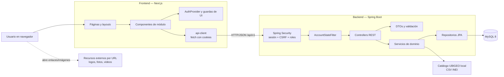
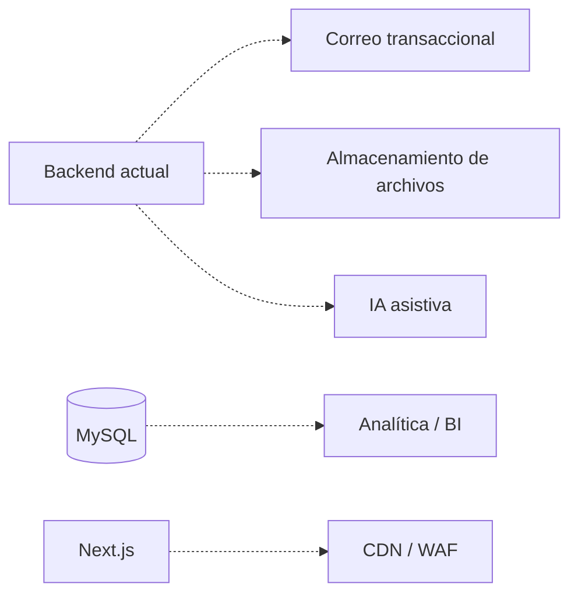

# 02 — Arquitectura actual

## 1. Vista general

La arquitectura implementada es un **frontend Next.js desacoplado de un backend Spring Boot**, con MySQL como base de datos. La comunicación se realiza por HTTP/JSON contra el prefijo `/api/v1`.

No se encontraron microservicios, mensajería asíncrona, servicios cloud, colas, caché distribuida ni integraciones externas de negocio.



## 2. Componentes

### 2.1 Cliente

Navegador web. No hay aplicación móvil ni cliente de escritorio.

### 2.2 Frontend

- Next.js App Router.
- React y TypeScript.
- Componentes cliente para formularios, tablas, tarjetas y navegación.
- `AuthProvider` mantiene el usuario de sesión en memoria.
- `api-client.ts` centraliza las solicitudes, incluye cookies y agrega CSRF en escrituras.
- No hay SSR de datos de negocio: las pantallas cargan información desde la API en el cliente.

### 2.3 Backend

- `ScoutingApplication` es el punto de entrada Spring Boot.
- Controllers REST reciben y devuelven DTOs.
- Servicios de dominio aplican reglas y transacciones.
- Repositorios Spring Data JPA acceden a MySQL.
- `SecurityConfig` define autenticación, autorización, CSRF y CORS.
- `AccountStateFilter` revalida en cada petición el estado de la cuenta y la obligación de cambiar contraseña.

### 2.4 Base de datos

- MySQL 8, InnoDB, utf8mb4.
- Esquema generado/actualizado por JPA/Hibernate.
- No hay migraciones versionadas.
- El catálogo UBIGEO no está en MySQL: se sirve desde un CSV local empaquetado.

### 2.5 Seguridad

- Sesión de servidor, no JWT.
- Cookie HttpOnly; `SameSite=Lax`; `Secure` configurable.
- CSRF para POST/PUT/PATCH/DELETE.
- BCrypt para contraseñas.
- Autorización por rol en configuración y por anotaciones `@PreAuthorize`.
- Validación adicional de alcance dentro de servicios.
- Filtro de estado de cuenta por petición.

### 2.6 Almacenamiento de archivos

No existe almacenamiento binario. El modelo guarda URLs de logo, foto y video. El navegador resuelve esos enlaces directamente; el backend no descarga los archivos.

## 3. Recorrido de una solicitud

Ejemplo: el ojeador consulta un jugador.

1. El navegador abre una ruta de Next.js.
2. `AuthProvider` obtiene `/api/v1/auth/me` para conocer la sesión.
3. La página monta un componente cliente y solicita el recurso con `apiRequest`.
4. El navegador envía la cookie de sesión.
5. Spring Security valida la sesión.
6. `AccountStateFilter` confirma que la cuenta sigue activa y sin contraseña temporal pendiente.
7. El controller correspondiente valida rol y parámetros.
8. El servicio aplica el alcance por rol (por ejemplo, ocultar distrito al ojeador).
9. El repositorio consulta MySQL.
10. El backend devuelve un DTO JSON con `Cache-Control` cuando corresponde.
11. Next.js renderiza la respuesta.

### Escrituras

En POST/PUT/PATCH:

1. El cliente obtiene y conserva el token CSRF de la sesión.
2. `apiMutation` envía `X-CSRF-TOKEN`.
3. Spring Security valida el token antes del controller.
4. El servicio valida reglas de negocio y transacción.
5. Se devuelve el DTO o un error uniforme.

## 4. Despliegue actual

No hay evidencia de despliegue productivo. El repositorio está preparado para ejecución local:

```text
Next.js local (por defecto 3000)
        ↓
Spring Boot local (9193 en la configuración actual)
        ↓
MySQL local (3306)
```

No existen:

- Dockerfile ni Docker Compose;
- proxy inverso;
- configuración TLS;
- dominio;
- CI/CD;
- backups automatizados;
- monitoreo o APM;
- gestor de secretos.

`application-prod.properties` solo refuerza la cookie Secure; no configura la infraestructura.

## 5. Componentes futuros, no implementados

Los siguientes componentes pueden mencionarse en una sección de trabajos futuros, pero **no deben dibujarse como parte de la arquitectura actual**:



## 6. Conclusión

La arquitectura actual es un **monolito backend con frontend desacoplado**. Es adecuada para un MVP académico y para un equipo pequeño, pero requiere migraciones versionadas, sesión compartida, TLS y observabilidad antes de un despliegue productivo serio.
