# 06 — Modelo de datos actual

## 1. Método y limitación

El modelo se reconstruyó a partir de las entidades JPA y se contrastó con una instancia MySQL local. No se inspeccionó una base de datos productiva.

- Fuente principal: `backend/scouting/src/main/java/com/scouting/scouting/**/entity/`.
- Configuración: `application.properties`.
- No hay Flyway ni scripts de migración versionados.
- La base local presentó diferencias de tipos (`snapshot_json` como `TINYTEXT`) que requirieron corrección manual a `LONGTEXT`. Esto demuestra que el esquema no está completamente versionado.

## 2. Tablas identificadas

| Tabla | Propósito | PK | Claves foráneas / restricciones | Relaciones principales |
|---|---|---|---|---|
| `users` | Cuenta de acceso y datos de identidad | `id` | unique email, username, document_number | 1:0..1 con `user_organizations`; 1:0..1 con `player_profiles` |
| `academies` | Academia deportiva | `id` | unique code, unique ruc | 1:N con `user_organizations`; 1:N con `academy_training_groups` |
| `academy_training_groups` | Grupos formativos de academia (element collection) | `(academy_id, sort_order)` | FK `academy_id` | N:1 con `academies` |
| `clubs` | Club deportivo | `id` | unique code, unique ruc | 1:N con `user_organizations`; 1:N con recomendaciones y respuestas |
| `user_organizations` | Asignación única de una cuenta a academia o club | `id` | unique user_id; check exactamente academia o club | N:1 con `users`, `academies`, `clubs` |
| `organization_code_sequences` | Secuencia de códigos visibles de organizaciones | `organization_type` | — | Tabla independiente usada por el generador de códigos |
| `player_profiles` | Perfil deportivo de una cuenta PLAYER | `id` | unique user_id; FK user_id, created_by, updated_by | 1:1 con `users`; 1:N con historial y prospectos |
| `player_guardians` | Tutor restringido de un menor | `id` | unique player_profile_id; FK player_profile_id, created_by, updated_by | 1:1 con `player_profiles` |
| `player_guardian_consent_events` | Eventos append-only de consentimiento | `id` | FK player_profile_id, recorded_by_user_id | N:1 con `player_profiles`; N:1 con `users` |
| `player_history_entries` | Actividad deportiva | `id` | FK player_profile_id, created_by, last_modified_by | N:1 con `player_profiles`; 1:N con métricas y revisiones |
| `player_history_metrics` | Métricas posicionales | `id` | unique `(history_entry_id, metric_code)` | N:1 con `player_history_entries` |
| `player_history_revisions` | Revisión auditable de historial | `id` | unique `(history_entry_id, revision_number)` | N:1 con `player_history_entries`; N:1 con `users` |
| `prospects` | Seguimiento privado de un jugador por un ojeador | `id` | unique `(scout_id, player_id)`; FK scout_id, player_id | N:1 con `users` (SCOUT) y `player_profiles`; 1:N con evaluaciones y recomendaciones |
| `prospect_evaluations` | Evaluación privada e inmutable | `id` | FK prospect_id, created_by_user_id | N:1 con `prospects`; N:1 con `users` |
| `recommendations` | Recomendación de ojeador a club | `id` | unique `(prospect_id, club_id)`; FK prospect_id, club_id, scout_id | N:1 con `prospects`, `clubs`, `users`; 1:N con joins y respuestas |
| `recommendation_history_entries` | Historial seleccionado en una recomendación | `id` | unique `(recommendation_id, history_entry_id)` | N:1 con `recommendations` y `player_history_entries` |
| `recommendation_evaluations` | Evaluación seleccionada en una recomendación | `id` | unique `(recommendation_id, evaluation_id)` | N:1 con `recommendations` y `prospect_evaluations` |
| `recommendation_responses` | Respuesta append-only del club | `id` | FK recommendation_id, club_id, responded_by_user_id | N:1 con `recommendations`, `clubs`, `users` |

## 3. Diagrama Entidad–Relación

```mermaid
erDiagram
    USER ||--o| USER_ORGANIZATION : "se asigna"
    ACADEMY ||--o{ USER_ORGANIZATION : "acoge"
    CLUB ||--o{ USER_ORGANIZATION : "acoge"
    ACADEMY ||--o{ ACADEMY_TRAINING_GROUP : "grupos"

    USER ||--o| PLAYER_PROFILE : "tiene perfil"
    PLAYER_PROFILE ||--o| PLAYER_GUARDIAN : "tutor"
    PLAYER_PROFILE ||--o{ PLAYER_GUARDIAN_CONSENT_EVENT : "consentimiento"
    PLAYER_PROFILE ||--o{ PLAYER_HISTORY_ENTRY : "historial"
    PLAYER_HISTORY_ENTRY ||--o{ PLAYER_HISTORY_METRIC : "metricas"
    PLAYER_HISTORY_ENTRY ||--o{ PLAYER_HISTORY_REVISION : "revisiones"

    USER ||--o{ PROSPECT : "ojea"
    PLAYER_PROFILE ||--o{ PROSPECT : "es seguido"
    PROSPECT ||--o{ PROSPECT_EVALUATION : "evaluaciones"

    PROSPECT ||--o{ RECOMMENDATION : "origina"
    CLUB ||--o{ RECOMMENDATION : "recibe"
    USER ||--o{ RECOMMENDATION : "envia"

    RECOMMENDATION ||--o{ RECOMMENDATION_HISTORY_ENTRY : "selecciona"
    PLAYER_HISTORY_ENTRY ||--o{ RECOMMENDATION_HISTORY_ENTRY : "incluido"

    RECOMMENDATION ||--o{ RECOMMENDATION_EVALUATION : "selecciona"
    PROSPECT_EVALUATION ||--o{ RECOMMENDATION_EVALUATION : "incluida"

    RECOMMENDATION ||--o{ RECOMMENDATION_RESPONSE : "respuestas"
    CLUB ||--o{ RECOMMENDATION_RESPONSE : "responde"
    USER ||--o{ RECOMMENDATION_RESPONSE : "registra"

    USER {
        bigint id PK
        string email UK
        string username UK
        string password_hash
        string first_name
        string last_name
        string document_type
        string document_number UK
        string phone
        string role
        string status
        boolean must_change_password
        datetime temporary_password_expires_at
        datetime created_at
        datetime updated_at
    }

    USER_ORGANIZATION {
        bigint id PK
        bigint user_id FK
        bigint academy_id FK
        bigint club_id FK
        string position
        datetime created_at
    }

    ACADEMY {
        bigint id PK
        string code UK
        string name
        string type
        string ruc UK
        int foundation_year
        string logo_url
        string description
        string ubigeo_code
        string address
        string institutional_email
        string institutional_phone
        string headquarters
        string representative_name
        string operational_status
        string verification_status
        bigint version
        datetime created_at
        datetime updated_at
    }

    ACADEMY_TRAINING_GROUP {
        bigint academy_id FK
        int sort_order
        string group_name
    }

    CLUB {
        bigint id PK
        string code UK
        string name
        string type
        string ruc UK
        int foundation_year
        string logo_url
        string description
        string country_code
        string ubigeo_code
        string address
        string institutional_email
        string institutional_phone
        string operational_status
        string verification_status
        bigint version
        datetime created_at
        datetime updated_at
    }

    PLAYER_PROFILE {
        bigint id PK
        bigint user_id FK
        date birth_date
        string residence_ubigeo_code
        int height_cm
        decimal weight_kg
        string position
        string best_position
        string dominant_foot
        string summary
        string photo_url
        string operational_status
        string profile_status
        datetime completed_at
        bigint created_by_user_id FK
        bigint updated_by_user_id FK
        bigint version
        datetime created_at
        datetime updated_at
    }

    PLAYER_GUARDIAN {
        bigint id PK
        bigint player_profile_id FK
        string first_name
        string last_name
        string document_type
        string document_number
        string phone
        string address
        string relationship
        bigint created_by_user_id FK
        bigint updated_by_user_id FK
        bigint version
        datetime created_at
        datetime updated_at
    }

    PLAYER_GUARDIAN_CONSENT_EVENT {
        bigint id PK
        bigint player_profile_id FK
        string status
        datetime recorded_at
        bigint recorded_by_user_id FK
        string evidence_url
        string note
    }

    PLAYER_HISTORY_ENTRY {
        bigint id PK
        bigint player_profile_id FK
        string activity_type
        date activity_date
        string competition
        string opponent
        string age_category
        string competitive_level
        string position_played
        string participation
        int minutes_played
        string team_result
        int team_goals
        int opponent_goals
        int player_goals
        int assists
        int yellow_cards
        int red_cards
        string observations
        string video_url
        int video_timestamp_seconds
        string video_description
        int technical_rating
        int tactical_rating
        int physical_rating
        int mental_rating
        int overall_rating
        string strengths
        string improvements
        string recommendations
        bigint created_by_user_id FK
        bigint last_modified_by_user_id FK
        int revision_number
        bigint version
        datetime created_at
        datetime updated_at
    }

    PLAYER_HISTORY_METRIC {
        bigint id PK
        bigint history_entry_id FK
        string metric_group
        string metric_code
        decimal numeric_value
    }

    PLAYER_HISTORY_REVISION {
        bigint id PK
        bigint history_entry_id FK
        int revision_number
        string change_type
        string reason
        text snapshot_json
        bigint edited_by_user_id FK
        datetime edited_at
    }

    PROSPECT {
        bigint id PK
        bigint scout_id FK
        bigint player_id FK
        string status
        string private_notes
        datetime started_at
        datetime last_activity_at
        datetime closed_at
        bigint version
        datetime created_at
        datetime updated_at
    }

    PROSPECT_EVALUATION {
        bigint id PK
        bigint prospect_id FK
        bigint created_by_user_id FK
        date evaluated_at
        int technical_rating
        int tactical_rating
        int physical_rating
        int mental_rating
        int overall_rating
        string strengths
        string improvements
        string recommendation
        string private_notes
        string video_url
        datetime created_at
    }

    RECOMMENDATION {
        bigint id PK
        bigint prospect_id FK
        bigint club_id FK
        bigint scout_id FK
        string status
        string message
        text snapshot_json
        string authorization_type
        datetime authorized_at
        datetime sent_at
        bigint version
        datetime created_at
        datetime updated_at
    }

    RECOMMENDATION_HISTORY_ENTRY {
        bigint id PK
        bigint recommendation_id FK
        bigint history_entry_id FK
    }

    RECOMMENDATION_EVALUATION {
        bigint id PK
        bigint recommendation_id FK
        bigint evaluation_id FK
    }

    RECOMMENDATION_RESPONSE {
        bigint id PK
        bigint recommendation_id FK
        bigint club_id FK
        bigint responded_by_user_id FK
        string status
        string message
        datetime responded_at
    }

    ORGANIZATION_CODE_SEQUENCE {
        string organization_type PK
        bigint next_value
    }
```

## 4. Claves y restricciones relevantes

### `users`

- PK: `id`.
- Unique: `email`, `username`, `document_number`.
- Campos sensibles: `password_hash`, `temporary_password_expires_at`; no se exponen en DTOs generales.

### `user_organizations`

- Unique `user_id`: una cuenta tiene como máximo una organización.
- Check: exactamente una academia o un club.
- `position` solo se admite en asociación de club.
- Roles de academia: `ACADEMY_DIRECTOR`, `PROFESSOR`, `PLAYER`.
- Rol de club: `CLUB_MANAGER`.

### `academies` y `clubs`

- Unique `code` y `ruc`.
- `operationalStatus` y `verificationStatus` son independientes.
- `academy_training_groups` es una colección de cadenas; no hay entidad de sede.
- `representative_name` de academia es un valor legacy/respaldo; el nombre mostrado se deriva del Director activo.

### Historial

- `player_history_metrics`: unique `(history_entry_id, metric_code)`.
- `player_history_revisions`: unique `(history_entry_id, revision_number)`.
- `snapshot_json` debe ser `LONGTEXT` para soportar el JSON completo.
- Las correcciones no borran la entrada original.

### Prospección

- Unique `(scout_id, player_id)`.
- `private_notes` y `prospect_evaluations.private_notes` son privados.
- Las evaluaciones no tienen endpoint de actualización ni borrado.

### Recomendaciones

- Unique `(prospect_id, club_id)`.
- `snapshot_json` debe ser `LONGTEXT`.
- Joins únicos para historiales y evaluaciones seleccionadas.
- `recommendation_responses` es append-only.
- La respuesta vigente es la última por `responded_at`/`id`.

## 5. Índices identificados

| Tabla | Índice / restricción |
|---|---|
| `prospects` | `uk_prospects_scout_player`, `idx_prospects_scout_status`, `idx_prospects_scout_last_activity`, `idx_prospects_player` |
| `prospect_evaluations` | `idx_prospect_evaluations_prospect_date` |
| `recommendations` | `uk_recommendations_prospect_club`, `idx_recommendations_club_sent`, `idx_recommendations_scout_sent` |
| `recommendation_responses` | `idx_recommendation_responses_recommendation_date` |
| `player_history_metrics` | `uk_player_history_metrics_entry_code` |
| `player_history_revisions` | `uk_player_history_revisions_entry_number` |
| `users` | `uk_users_email`, `uk_users_username`, `uk_users_document_number` |
| `academies`, `clubs` | unique code y unique RUC |
| `user_organizations` | unique user_id |

## 6. Enumeraciones del modelo

| Enum | Valores |
|---|---|
| `Role` | `ADMIN`, `PROFESSOR`, `ACADEMY_DIRECTOR`, `SCOUT`, `CLUB_MANAGER`, `PLAYER` |
| `UserStatus` | `ACTIVE`, `PENDING_APPROVAL`, `INACTIVE` |
| `OperationalStatus` | `ACTIVE`, `INACTIVE` |
| `VerificationStatus` | `PENDING_VERIFICATION`, `VERIFIED`, `REJECTED` |
| `PlayerOperationalStatus` | `ACTIVE`, `INACTIVE` |
| `PlayerProfileStatus` | `INCOMPLETE`, `COMPLETE` |
| `ProspectStatus` | `FOLLOWING`, `PAUSED`, `CLOSED` |
| `RecommendationStatus` | `SENT`, `RESPONDED` |
| `RecommendationAuthorizationType` | `GUARDIAN_CONSENT`, `SCOUT_SEND` |
| `RecommendationResponseStatus` | `INTERESTED`, `INFO_REQUESTED`, `NOT_INTERESTED` |
| `GuardianConsentStatus` | `NOT_RECORDED`, `GRANTED`, `DENIED`, `REVOKED` |
| `ActivityType` | `OFFICIAL_MATCH`, `FRIENDLY_MATCH`, `TOURNAMENT`, `TRAINING`, `SPORTS_TRIAL` |
| `Participation` | `STARTER`, `SUBSTITUTE`, `DID_NOT_PLAY` |
| `TeamResult` | `WIN`, `DRAW`, `LOSS` |
| `AgeCategory` | `SUB_8` a `SENIOR` |
| `CompetitiveLevel` | `ACADEMY`, `LOCAL`, `REGIONAL`, `NATIONAL`, `INTERNATIONAL` |
| `DominantFoot` | `LEFT`, `RIGHT`, `BOTH` |
| `PositionGroup` | `GOALKEEPER`, `DEFENDER`, `MIDFIELDER`, `FORWARD` |

## 7. Inconsistencias y observaciones

1. `docs/modelo-datos.md` menciona entidades propuestas `Ojeador`, `OjeadorClub` y `Evidencia` que no existen como tablas en el código actual.
2. No hay tabla de sedes; solo `academies.headquarters`.
3. `academy_training_groups` existe como colección JPA, aunque la interfaz ya no captura grupos formativos.
4. `representative_name` es un valor legacy; el representante se deriva del Director activo.
5. El esquema local requirió ampliar `player_history_revisions.snapshot_json` y `recommendations.snapshot_json` a `LONGTEXT`; JPA/Hibernate no corrigió automáticamente columnas existentes.
6. No hay migraciones versionadas; el esquema depende de `ddl-auto=update` y de ajustes manuales.
7. Los conteos de organizaciones no son columnas persistidas; se devuelven como proyecciones y actualmente suelen ser `null`.

